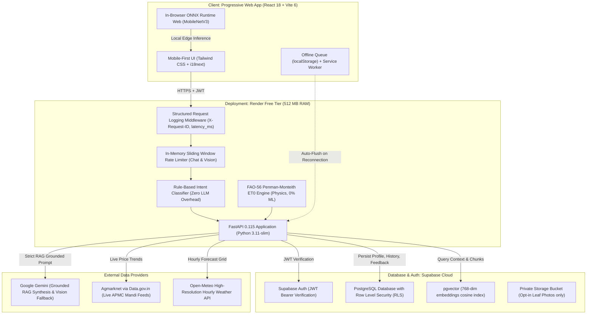

# KisanSathi Rajasthan (किसान साथी राजस्थान)
**AI-Assisted Decision-Support System for Smallholder Farmers in Rajasthan, India**  
*Academic Final-Year Capstone Project — Scientific Rigor, Grounded RAG, In-Browser Edge ML & Complete Transparency*

[](https://fastapi.tiangolo.com)
[](https://react.dev)
[](https://supabase.com)
[-46E3B7.svg?logo=render)](https://render.com)
[](https://opensource.org/licenses/MIT)

---

## 🌾 1. Product Overview

Smallholder farmers across Rajasthan face extreme climatic variability (arid and semi-arid agro-climatic zones), unpredictable rainfall, localized pest infestations, groundwater depletion, and sharp price swings at local APMC mandis. 

**KisanSathi Rajasthan** is a production-grade, bilingual (Hindi default, English supported) decision-support progressive web application (PWA). It empowers farmers with personalized, risk-free agronomic advice grounded strictly in official university Package of Practices (POP) from **ICAR-CAZRI Jodhpur, Agriculture University Kota, SKNAU Jobner, and SKRAU Bikaner**.

### Core Modules
1. **Personalized Farm Profile**: Captures farmer's district (across all 33 administrative Rajasthan districts), tehsil, primary crop, landholding (with automatic Bigha-to-Hectare conversion), irrigation source, and sowing date.
2. **Advisor Chat (Grounded RAG)**: Text and voice query answering backed by pgvector cosine search and Gemini 1.5 Flash grounded strictly in verified Rajasthan agriculture university bulletins. Zero dosage hallucinations.
3. **Crop Disease Diagnosis**: Real-time foliar lesion identification executed directly **in the browser via ONNX Runtime Web** (MobileNetV3). When confidence falls below 70%, the system safely redirects to the nearest Krishi Vigyan Kendra (KVK). Server-side vision fallback available.
4. **District Yield Outlook**: Historical district production forecasts ($kg/ha$) benchmarked against 5-year rolling district baselines with Leave-One-Year-Out (LOYO) and Leave-One-District-Out (LODO) validation.
5. **Mandi Price Forecasts**: Real-time APMC arrivals and prices from Agmarknet (Data.gov.in API) with persistence baseline trends and short-term forecast intervals.
6. **Weather & Irrigation Scheduling**: Deterministic physics engine computing reference crop evapotranspiration ($ET_0$) using the **FAO-56 Penman-Monteith method** paired with high-resolution hourly Open-Meteo forecasts and university crop growth stage coefficients ($K_c$).
7. **PWA Offline Resilience & Feedback**: Offline storage for profile, prices, weather schedules, and disease advice; offline chat queuing in `localStorage` with automatic reconnection flush; thumbs up/down and actual outcome tracking (`public.feedback`).

*Explicitly Out of Scope*: Satellite remote sensing imagery, commercial payment gateways, SMS/IVR telephony modems, proprietary paid APIs.

---

## 🏛️ 2. System Architecture



### Free-Tier Architectural Hardening (Render 512MB RAM Budget)
1. **Zero PyTorch on Server**: Server runs pure Python math, lightweight FastAPI, and standard libraries. Neural network vision inference is offloaded entirely to the client device via WebAssembly/WebGPU (`ort-wasm-simd-threaded.wasm`).
2. **Deterministic Physics over Large Models**: Irrigation uses the standard FAO-56 Penman-Monteith energy balance equation rather than memory-heavy regression models.
3. **Sliding-Window Rate Limiting**: Chat and vision endpoints are shielded by `SlidingWindowRateLimiter` (20 req/min for chat, 10 req/min for diagnosis) to prevent container CPU throttling.
4. **Structured JSON Logging**: Every request emits structured metrics (`request_id`, `client_ip`, `latency_ms`, `status_code`) with header injection (`X-Request-ID`).

---

## 📋 3. Completed Roadmap

- [x] **Phase 0: Architecture, Toolchain & Monorepo Scaffold**
  - Monorepo directory structure, Docker container, render.yaml, CI workflow, .env templates.
  - Strict CORS policy (whitelist only, never `*`).
- [x] **Phase 1: Database, Supabase Auth & Farm Profile Management**
  - Full PostgreSQL schema with tables: `profiles`, `farms`, `kb_chunks`, `mandi_prices`, `disease_predictions`, `messages`, `feedback`.
  - Row Level Security (RLS) enforced across all tables (`auth.uid() = user_id`).
  - Bigha-to-Hectare converter and personal farm context injection.
- [x] **Phase 2: RAG Knowledge Base & Gemini Advisor Chat**
  - Agriculture manuals from ICAR-CAZRI, SKNAU, AU Kota converted and chunked.
  - 768-dimensional vector embeddings stored with pgvector HNSW index.
  - Rule-based regex intent classifier routing queries to RAG context.
  - Strict grounding: zero dosage hallucination; mandatory KVK referral on low relevance.
- [x] **Phase 3: District Crop Yield Outlook**
  - Official DES Rajasthan agricultural production dataset (2018–2024).
  - 33 standardized Rajasthan districts; 6 staple crops (Mustard, Bajra, Wheat, Gram, Soybean, Cluster Bean).
  - Leave-One-Year-Out (LOYO) and Leave-One-District-Out (LODO) validation scripts.
  - Honest fallback to 5-year rolling district historical average (`model_version = "baseline"`).
- [x] **Phase 4: Mandi Price Trends & Forecasting**
  - Agmarknet daily collector with valid Data.gov.in API key.
  - Daily commodity rates and arrivals upserted to database.
  - Walk-forward validation over 14-day and 28-day forecasting horizons.
- [x] **Phase 5: In-Browser Crop Disease Diagnosis**
  - 25,943 foliar images partitioned into non-leaking train/val/test splits with MD5 deduplication.
  - Client-side ONNX Runtime Web integration with canvas resizing and EXIF stripping.
  - Confidence threshold (< 0.70) safe fallback to KVK referral.
- [x] **Phase 6: Weather & Irrigation Scheduling**
  - High-resolution hourly Open-Meteo weather integration.
  - FAO-56 Penman-Monteith physics calculating daily reference evapotranspiration ($ET_0$).
  - Crop coefficients ($K_c$) mapping days since sowing to crop water needs.
  - State agro-university weather warnings (frost, heatwave, unseasonal rain).
- [x] **Phase 7: PWA Offline Resilience, History, Feedback & Production Hardening**
  - Offline caching of profile, prices, weather advice, and disease diagnoses.
  - Chat offline queue in `localStorage` with automatic reconnection flush.
  - Public `/system/metadata` endpoint and dynamic `/about` page reading live metrics.
  - Advisory history timeline (`/history`) with intent filtering and feedback status.
  - User feedback loop (`/feedback`) with thumbs up/down and actual outcome recordings.
  - Structured request logging middleware and sliding-window rate limiters.
  - ErrorBoundary and bilingual 404 page.

---

## 🔒 4. Security, Privacy & Safety Guidelines

1. **Frontend Secret Hygiene**: Only `VITE_SUPABASE_URL` and `VITE_SUPABASE_ANON_KEY` are exposed to the client. The database connection string, service role key, and Gemini API keys reside exclusively in backend environment variables.
2. **Row Level Security (RLS)**: Enforced in Postgres via `auth.uid() = user_id`. No farmer can view, modify, or delete another user's farm profile, chat history, or diagnosis records.
3. **EXIF Stripping & Privacy**: All uploaded images are sanitized in memory to strip camera metadata and GPS coordinates before processing. Photos are stored in Supabase private buckets **only** when the user explicitly checks the opt-in checkbox.
4. **Hallucination Prevention**: Prompts strictly constrain Gemini to retrieved university context. If treatment information is absent, the system responds:
   > *"मुझे इस विषय में पूरी जानकारी नहीं है, कृपया अपने नजदीकी कृषि विज्ञान केंद्र (KVK) से संपर्क करें।"*

---

## 🚀 5. Local Development Setup

### Prerequisites
- Python 3.11+
- Node.js 20+ & npm

### Backend Setup
```bash
# 1. Open backend directory
cd backend

# 2. Create virtual environment
python3 -m venv venv
source venv/bin/activate  # Windows: venv\Scripts\activate

# 3. Install dependencies
pip install -r requirements.txt

# 4. Configure environment
cp .env.example .env
# Fill in DATABASE_URL, SUPABASE_JWT_SECRET, GEMINI_API_KEY

# 5. Run automated test suite
pytest -v tests/

# 6. Start backend development server
uvicorn app.main:app --reload --port 8000
```
Interactive OpenAPI documentation will be accessible at: `http://localhost:8000/docs`

### Frontend Setup
```bash
# 1. Open frontend directory
cd frontend

# 2. Install dependencies
npm install

# 3. Configure environment
cp .env.example .env
# Configure VITE_SUPABASE_URL and VITE_SUPABASE_ANON_KEY

# 4. Start Vite development server
npm run dev
```
Open `http://localhost:5173` in your browser.

---

## 🧪 6. Evaluation Instructions

All evaluation scripts execute real, transparent mathematical verifications without fabricated metrics:

### 1. Evaluate Yield Baseline (LOYO & LODO Cross-Validation)
```bash
python scripts/evaluate_yield.py --input data/yield_data/cleaned_yield.csv --crop mustard
```
*Output: LOYO MAE: 194.75 kg/ha (RMSE 253.42 kg/ha) | LODO MAE: 256.89 kg/ha (RMSE 323.09 kg/ha).*

### 2. Evaluate Mandi Price Walk-Forward Forecasts
```bash
python scripts/evaluate_price.py --input data/mandi_data/cleaned_mandi.csv --commodity Mustard --mandi "Rajasthan APMC"
```
*Evaluates rolling walk-forward MAE and persistence baseline across 14-day and 28-day forecasting windows.*

### 3. Evaluate Disease Dataset Deduplication & Class Splits
```bash
python scripts/prepare_disease_dataset.py --verify-only
```
*Confirms 25,943 total images across 24 classes with 0% cross-split duplicate leakage.*

### 4. Evaluate RAG Knowledge Grounding & Hallucination Rate
```bash
python scripts/evaluate_rag.py --eval-file data/rag_eval_questions.csv
```
*Measures Citation Grounding Rate (Target: 100%) and Hallucination Rate for ungrounded chemicals (Target: 0.0%).*

### 5. Run Full Backend Unit & Integration Tests
```bash
backend/venv/bin/pytest backend/tests/
```
*Runs all 72 test cases across authentication, schemas, RAG grounding, intent routing, rate limiting, and system transparency.*

---

## ☁️ 7. Production Deployment Instructions

### Backend (Render Free-Tier Web Service)
1. In the [Render Dashboard](https://dashboard.render.com), create a new **Web Service** connected to your repository.
2. Select **Docker** environment using root `Dockerfile`.
3. Set environment variables:
   - `ENVIRONMENT=production`
   - `DATABASE_URL` (Supabase pooled connection string `postgresql://...:6543/postgres`)
   - `SUPABASE_URL` (`https://<project-ref>.supabase.co`)
   - `SUPABASE_JWT_SECRET` (Supabase Project Settings > API > JWT Secret)
   - `GEMINI_API_KEY` (Google AI Studio Key)
   - `FRONTEND_ORIGIN` (`https://your-frontend-app.vercel.app`)
4. Health check path: `/health`.

### Frontend (Vercel or Netlify)
1. Import repository to Vercel or Netlify.
2. Root directory: `frontend`.
3. Build command: `npm run build`.
4. Output directory: `dist`.
5. Environment variables:
   - `VITE_SUPABASE_URL`
   - `VITE_SUPABASE_ANON_KEY`
   - `VITE_API_BASE_URL` (`https://your-render-backend.onrender.com`)

---

## ⚠️ 8. Known Limitations & Explicit Boundaries

1. **Server RAM Ceiling**: Designed specifically for the Render 512MB RAM cap. Heavy server-side neural networks are intentionally avoided; vision tasks run on the client via WebAssembly.
2. **Deterministic Baseline Fallbacks**: When specialized ML models are not yet trained on verified multi-year historical series, the system explicitly reports `model_version: "baseline"`. We never fabricate synthetic predictions.
3. **Agmarknet Arrival Delays**: Mandi price data relies on the official Data.gov.in API feed; local APMC market closures on Sundays or holidays are reflected as unchanged modal prices.
4. **Camera & Lighting Sensitivity**: Browser-side leaf disease detection requires clear focus and natural daylight. For ambiguous lesions, the system enforces a strict $< 70\%$ confidence fallback redirecting farmers to certified KVK extension officers.
5. **Non-Clinical Advisory Scope**: Outputs from this platform serve as decision-support guidance only and do not replace certified physical inspections by state agricultural field supervisors.

---

## ⚖️ 9. License & Attribution
- **License**: MIT Open Source License.
- **Academic Grounding**: ICAR-CAZRI (Jodhpur), Agriculture University Kota, SKNAU (Jobner), SKRAU (Bikaner).
- **Data Providers**: Directorate of Economics & Statistics (DES Rajasthan), Agmarknet / Data.gov.in, Open-Meteo.
