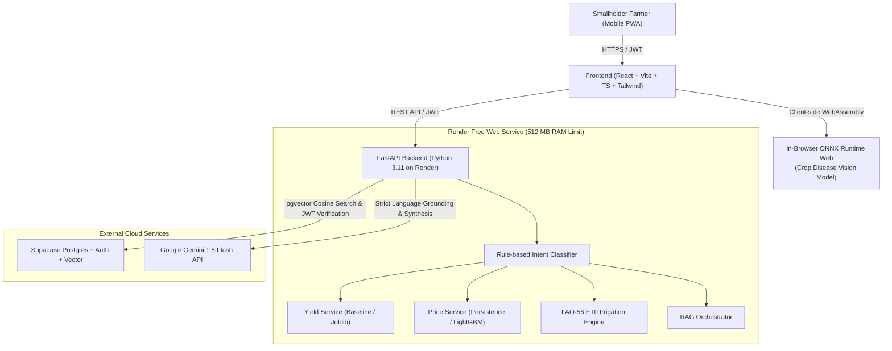

# KisanSathi Rajasthan: System Architecture

## Overview
KisanSathi Rajasthan is an AI-assisted decision-support web application tailored for smallholder farmers across Rajasthan, India. Designed as an academic final-year capstone, the system enforces clean design, testability, safety, and strict honesty in data and ML claims.

---

## 1. Free-Tier Operational Constraints & Solutions

| Constraint on Free Tier | Architectural Solution |
| :--- | :--- |
| **Render 512 MB RAM Limit** | No PyTorch, torchvision, or sentence-transformers in the backend container. Tabular models use lightweight scikit-learn/LightGBM (`.joblib`). Vision models run client-side in the browser via ONNX Runtime Web. Single worker uvicorn process. |
| **Ephemeral Filesystem** | No local SQLite, ChromaDB, or local file uploads. All persistent data resides in Supabase Postgres and Supabase Storage. Uploaded diagnostic images are processed in-memory, EXIF-stripped, and discarded unless the user explicitly opts in. |
| **Idle Sleeping (15 min)** | Clean `/health` probe for automated uptime pings. Frontend PWA service worker caches farmer profile, offline recommendations, and latest mandi rates so the UI never breaks on backend wake-up latency. |
| **Free Gemini API Quota** | Gemini Flash is called *only* for language synthesis and explanation over retrieved context. Heavy tasks (intent classification, ET0 calculations, statistical aggregations) run deterministically in Python. |

---

## 2. Intent Routing & Orchestration Flow

1. **Incoming Request**: Farmer asks a question in Hindi or English (text or voice).
2. **Intent Classification**: Evaluated with deterministic regex rules (`services/intent.py`) into: `price`, `yield`, `weather`, `disease`, or `general`.
3. **Domain Service Dispatch**:
   - `price` -> Queries Supabase `mandi_prices` and computes 2-4 week forecast.
   - `yield` -> Computes district yield outlook and drivers.
   - `weather` -> Evaluates FAO-56 Penman-Monteith ET0 and irrigation schedule.
   - `disease` -> Evaluates verified treatment from agricultural manual.
   - `general` -> Executes pgvector similarity search over `kb_chunks`.
4. **Grounded Synthesis**: Structured result + farmer profile context passed to Gemini 1.5 Flash.
5. **Safety Assertion**: If no source matches or confidence is low, the pipeline outputs:
   *"मुझे इस विषय में पूरी जानकारी नहीं है, कृपया अपने नजदीकी कृषि विज्ञान केंद्र (KVK) से संपर्क करें।"*
6. **Persistence**: Saves question, intent, answer, sources JSONB, and `model_version` to `messages` table.

---

## 3. Security and Row Level Security (RLS)

- **Strict CORS**: `CORSMiddleware` allows only the configured `FRONTEND_ORIGIN` (e.g. `http://localhost:5173` or `https://kisansathi.vercel.app`), strictly disallowing `*`.
- **JWT Verification**: Every authenticated request presents a Supabase JWT. The FastAPI backend verifies the signature and scopes all queries to `auth.uid() = user_id`.
- **Zero Secrets in Frontend**: `VITE_` variables contain only public endpoints and anon keys. All database credentials and Gemini keys remain strictly in backend environment variables.
