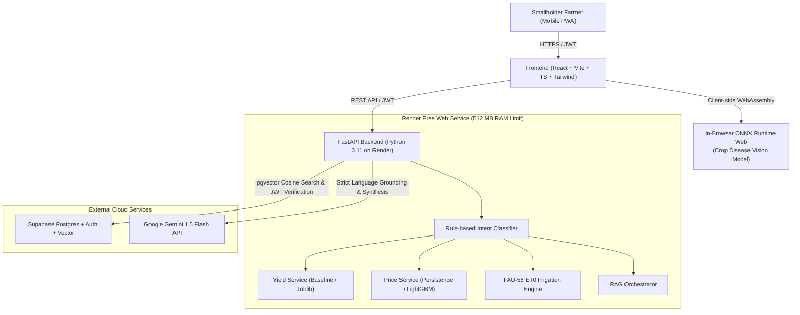

# KisanSathi Rajasthan: System Architecture

## Overview
KisanSathi Rajasthan is an AI-assisted decision-support web application tailored for smallholder farmers across Rajasthan, India. Designed as an academic final-year capstone, the system enforces clean design, testability, safety, and strict honesty in data and ML claims.

---

## 1. Free-Tier Operational Constraints & Solutions

| Constraint on Free Tier | Architectural Solution |
| :--- | :--- |
| **Render 512 MB RAM Limit** | No PyTorch, torchvision, or sentence-transformers in the backend container. Tabular models use lightweight scikit-learn/LightGBM (`.joblib`). Vision models run client-side in the browser via ONNX Runtime Web. Single worker uvicorn process. |
| **Ephemeral Filesystem** | No local SQLite, ChromaDB, or local file uploads. All persistent data resides in Supabase Postgres and Supabase Storage. Uploaded diagnostic images are processed in-memory, EXIF-stripped, and discarded unless the user explicitly opts in. |
| **Idle Sleeping (15 min)** | Clean `/health` probe for automated uptime pings. Frontend PWA service worker caches farmer profile, offline recommendations, and latest mandi rates so the UI never breaks on backend wake-up latency. |
| **Free Gemini API Quota** | Gemini Flash is called *only* for language synthesis and explanation over retrieved context. Heavy tasks (intent classification, ET0 calculations, statistical aggregations) run deterministically in Python. |

---

## 2. Intent Routing & Orchestration Flow

1. **Incoming Request**: Farmer asks a question in Hindi or English (text or voice).
2. **Intent Classification**: Evaluated with deterministic regex rules (`services/intent.py`) into: `price`, `yield`, `weather`, `disease`, or `general`.
3. **Domain Service Dispatch**:
   - `price` -> Queries Supabase `mandi_prices` and computes 2-4 week forecast.
   - `yield` -> Computes district yield outlook and drivers.
   - `weather` -> Evaluates FAO-56 Penman-Monteith ET0 and irrigation schedule.
   - `disease` -> Evaluates verified treatment from agricultural manual.
   - `general` -> Executes pgvector similarity search over `kb_chunks`.
4. **Grounded Synthesis**: Structured result + farmer profile context passed to Gemini 1.5 Flash.
5. **Safety Assertion**: If no source matches or confidence is low, the pipeline outputs:
   *"मुझे इस विषय में पूरी जानकारी नहीं है, कृपया अपने नजदीकी कृषि विज्ञान केंद्र (KVK) से संपर्क करें।"*
6. **Persistence**: Saves question, intent, answer, sources JSONB, and `model_version` to `messages` table.

---

## 3. Security and Row Level Security (RLS)

- **Strict CORS**: `CORSMiddleware` allows only the configured `FRONTEND_ORIGIN` (e.g. `http://localhost:5173` or `https://kisansathi.vercel.app`), strictly disallowing `*`.
- **JWT Verification**: Every authenticated request presents a Supabase JWT. The FastAPI backend verifies the signature and scopes all queries to `auth.uid() = user_id`.
- **Zero Secrets in Frontend**: `VITE_` variables contain only public endpoints and anon keys. All database credentials and Gemini keys remain strictly in backend environment variables.

---

## 4. Weather & Irrigation Module: Deterministic FAO-56 Physics & Rule Engine

> [!IMPORTANT]
> **Scientific Integrity & Zero Black-Box ML**: The Weather and Irrigation advisory module is strictly deterministic, physics-based, and agronomic rule-based. It does **NOT** use black-box neural networks or uncalibrated regression models. All irrigation volumes and countdowns stem directly from the **FAO Irrigation and Drainage Paper No. 56** Penman-Monteith standard, and all crop alerts originate from State Agricultural University (SAU) Packages of Practices.

### A. Mathematical Formulation (FAO-56 Penman-Monteith)

Reference Evapotranspiration ($ET_0$ in mm/day) is computed using the standardized FAO-56 equation:

$$ET_0 = \frac{0.408 \Delta (R_n - G) + \gamma \frac{900}{T_{\text{mean}} + 273} u_2 (e_s - e_a)}{\Delta + \gamma (1 + 0.34 u_2)}$$

Where:
- $\Delta$: Slope of saturation vapour pressure curve at mean air temperature ($\text{kPa}/^\circ\text{C}$).
- $R_n$: Net radiation at the crop surface ($\text{MJ}/\text{m}^2/\text{day}$).
- $G$: Soil heat flux density ($\text{MJ}/\text{m}^2/\text{day}$, negligible for daily steps $\approx 0$).
- $T_{\text{mean}}$: Mean daily air temperature at 2 m height ($^\circ\text{C}$).
- $u_2$: Wind speed at 2 m height ($\text{m}/\text{s}$), converted from 10 m anemometer readings via logarithmic wind profile equation $u_2 = u_{10} \times \frac{4.87}{\ln(67.8 \times 10 - 5.42)} \approx 0.748 \times u_{10}$.
- $e_s$: Saturation vapour pressure ($\text{kPa}$) derived from mean of $e^0(T_{\max})$ and $e^0(T_{\min})$.
- $e_a$: Actual vapour pressure ($\text{kPa}$) calculated from relative humidity $e_s \times (RH / 100)$.
- $\gamma$: Psychrometric constant ($\text{kPa}/^\circ\text{C}$) adjusted for district elevation $z$ ($P = 101.3 \times ((293 - 0.0065 z) / 293)^{5.26}$).

### B. Phenological Stage & Crop Evapotranspiration ($ET_c$)

Crop evapotranspiration under standard non-stressed conditions:
$$ET_c = K_c \times ET_0$$

Where $K_c$ follows piecewise-linear phenological curves:
1. **Initial ($K_{c,\text{ini}}$)**: Germination and seedling establishment (soil evaporation dominant, $K_c \approx 0.30 - 0.40$).
2. **Crop Development**: Vegetative growth to full ground cover (linear interpolation between $K_{c,\text{ini}}$ and $K_{c,\text{mid}}$).
3. **Mid-Season ($K_{c,\text{mid}}$)**: Flowering, pod/grain filling ($K_c \approx 1.05 - 1.20$, peak water requirement).
4. **Late Season ($K_{c,\text{end}}$)**: Senescence and ripening (linear decline towards harvest maturity, $K_c \approx 0.25 - 0.40$).

### C. Soil Water Balance & Irrigation Timing

Root-zone Available Water is computed dynamically based on root depth $Z_r$:
- Total Available Water: $TAW = 1000 \times (\theta_{FC} - \theta_{WP}) \times Z_r$
- Readily Available Water: $RAW = p \times TAW$ (where $p$ is crop-specific depletion fraction, typically $0.45 - 0.55$)
- Dynamic Irrigation Timing: Daily depletion rate is driven by net crop consumption $(ET_c - P_{\text{eff}})$. When cumulative depletion reaches $RAW$, irrigation is scheduled immediately.
- Method Efficiency adjustment: Net application volume is converted to gross requirement via application efficiency factors ($\eta_{\text{drip}} = 90\%$, $\eta_{\text{sprinkler}} = 75\%$, $\eta_{\text{flood}} = 60\%$).

### D. University-Grounded Crop Alert Rules

Alerts for frost, heat stress, humid disease outbreaks, rain withholding, and high wind are evaluated against `backend/reference/thresholds.json`. Each alert displays its institutional source (e.g. AU Kota, SKNAU Jobner, SKRAU Bikaner, ICAR-IIWBR) in the frontend banner so the farmer knows the precise origin of the advice.
